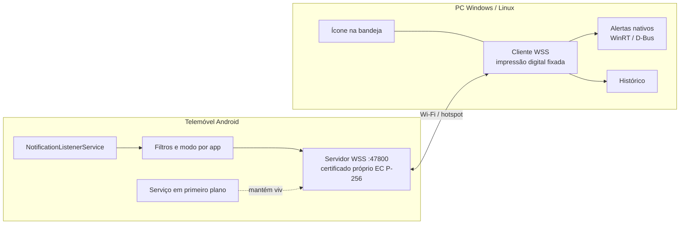

<p align="center">
  
</p>

<h1 align="center">Sync_Stonedge</h1>

<p align="center">
  As notificações do telemóvel Android no PC, em Windows 11 e Linux.<br>
  Rede local, cifrado, sem nuvem e sem contas.
</p>

<p align="center">
  <a href="../../actions/workflows/build.yml"></a>
  
  
  
  
</p>

---

## Propósito

O Sync_Stonedge nasceu de uma necessidade concreta: ver no computador, em tempo real, os alertas
que chegam ao telemóvel, sem depender de uma conta Microsoft, de um serviço na nuvem ou de uma
aplicação fechada que só existe para Windows.

É também uma peça do portefólio de [André Carmo](https://andrecarmo.pt), consultor de automação
e integração de sistemas com formação em Engenharia Eletrónica e Telecomunicações. O projeto junta
as áreas em que trabalho todos os dias: redes, protocolos, segurança, Android, aplicações de
desktop multiplataforma e entrega contínua. O código é meu, está aberto, e vai evoluir com novas
funções à medida que fizerem falta.

## O que faz (v0.1)

- Recebe no PC todas as notificações do telemóvel, com o nome e o ícone da app, o título, o texto
  e a fotografia do contacto quando existe (WhatsApp, Mensagens, Telegram, email...).
- Mostra-as como alertas nativos do Windows 11, que ficam guardados no Centro de Notificações.
  No Linux usa o sistema de notificações do ambiente de trabalho (D-Bus).
- Guarda um histórico pesquisável das últimas 300 notificações.
- Deixa escolher, app a app, entre **Enviar**, **Só o nome** (esconde o conteúdo) ou **Bloquear**.
  A lista inclui todas as apps instaladas, e as que forem instaladas no futuro seguem uma regra
  por omissão configurável.
- Quando o PC se liga, recebe um resumo das notificações que já estavam por ver.
- Modo "Não incomodar" e arranque automático com o sistema.

## Diferenças face às alternativas

| | Sync_Stonedge | Vínculo ao Telemóvel (Microsoft) | KDE Connect |
|---|---|---|---|
| Sistemas no PC | Windows 11 e Linux | Só Windows | Linux, Windows, macOS |
| Conta ou nuvem | Nenhuma | Conta Microsoft | Nenhuma |
| Funciona só com o hotspot do telemóvel | Sim, desenhado para isso | Depende de rede/Bluetooth | Sim |
| Firewall do PC | Não precisa de regras (o PC só faz ligações de saída) | Gerido pelo sistema | Precisa de portas abertas no PC |
| Alertas ficam no Centro de Notificações do Windows | Sim | Sim | Não (problema conhecido) |
| Filtro de duplicados (atualizações repetidas do WhatsApp) | Sim | Sim | Problemas conhecidos |
| Escolha por app: enviar, esconder conteúdo ou bloquear | Sim | Enviar ou bloquear | Sim |
| Código aberto e pequeno o suficiente para auditar | Sim (cerca de 2 700 linhas) | Não | Sim (projeto grande) |
| Âmbito | Focado em notificações, a crescer | Chamadas, SMS, fotos, ecrã | Muito amplo |

O objetivo não é substituir estas ferramentas em tudo o que fazem. É ter uma base própria, simples
e auditável, que resolve bem o essencial e onde cada nova função é decidida por quem a usa.

## Arquitetura



**Porque é o telemóvel o servidor.** Quando o PC está ligado ao hotspot do telemóvel, o Windows
classifica essa rede como "Pública" e bloqueia ligações de entrada. Com o PC como cliente, só há
ligações de saída e nada precisa de ser aberto na firewall do Windows nem no `ufw` do Ubuntu.

**Como o PC encontra o telemóvel.** Tenta, por esta ordem: o último IP conhecido, o gateway por
omissão (no hotspot, o gateway é o próprio telemóvel) e, por fim, mDNS/DNS-SD
(`_syncstonedge._tcp`) para quando ambos estão ligados a um router.

## Segurança

- Todo o tráfego vai cifrado em TLS. O telemóvel gera o seu próprio certificado EC P-256 na
  primeira execução; a chave privada nunca sai do armazenamento privado da app.
- Emparelhamento com um código de 6 dígitos mostrado no telemóvel, válido 5 minutos e limitado a
  5 tentativas. As duas apps mostram a impressão digital do certificado para comparação visual.
- Depois do emparelhamento, o PC fixa a impressão digital do certificado e autentica-se com um
  token aleatório de 256 bits. O telemóvel guarda apenas o hash SHA-256 desse token.
- Se o certificado mudar, o PC recusa enviar o token e pede um novo emparelhamento.
- O servidor só aceita ligações de endereços de rede local; nada passa pela Internet.

## Instalação

### Telemóvel (Android 8.0 ou superior)

Com o telemóvel ligado por cabo e a depuração USB ativa, no Windows:

```
scripts\windows\instalar_android.bat
```

O script transfere a versão mais recente, instala-a por ADB e concede as permissões (acesso às
notificações, bateria sem restrições, execução em segundo plano). Em alternativa, transfere o
`Sync_Stonedge.apk` da página de [releases](../../releases) e instala-o à mão.

**Xiaomi, Redmi e POCO (MIUI/HyperOS).** O sistema termina apps em segundo plano de forma
agressiva. Na app, usa os botões «Arranque automático (Xiaomi)» e «Retirar restrições de bateria».

### PC com Windows 11

```
scripts\windows\instalar_pc.bat
```

Instala o executável em `%LOCALAPPDATA%\Programs\Sync_Stonedge`, cria um atalho no menu Iniciar e
arranca a app. Não é preciso Python.

### PC com Linux (a partir do código)

```bash
cd desktop
python3 -m venv .venv && . .venv/bin/activate
pip install -r requirements.txt
python -m sync_stonedge            # com interface
python -m sync_stonedge --console  # só terminal, útil em servidores
```

No GNOME, o ícone na bandeja precisa da extensão AppIndicator (já incluída no Ubuntu).

## Utilização

1. No telemóvel, abre o Sync_Stonedge e confirma que as permissões estão a verde.
2. No PC, abre o Sync_Stonedge. Na primeira vez, procura o telemóvel e pede o código.
3. No telemóvel, toca em «Gerar código de emparelhamento» e escreve os 6 dígitos no PC.
4. Usa «Enviar notificação de teste» no telemóvel para confirmar.

O menu do ícone na bandeja dá acesso ao histórico, ao modo "Não incomodar", ao arranque automático
e a um novo emparelhamento.

## Plataformas testadas

| Componente | Plataforma | Estado |
|---|---|---|
| App Android | Xiaomi Redmi 11T (HyperOS) | Em teste |
| App de PC | Windows 11 | Em teste |
| App de PC | Ubuntu (GNOME) | Planeado |
| Protocolo | Simulador incluído (`tools/fake_phone.py`), CI no GitHub Actions | A passar |

## Desenvolvimento

```
android/   App Android em Kotlin (sem dependências da AndroidX)
desktop/   App de PC em Python (asyncio, websockets, desktop-notifier, pystray, Tkinter)
tools/     Simulador do telemóvel e gerador de ícones
scripts/   Instaladores para Windows
.github/   Compilação automática: APK, EXE do Windows e testes do protocolo
```

Testar a app de PC sem telemóvel:

```bash
python tools/fake_phone.py --port 47800          # mostra o PIN
python -m sync_stonedge --console --host 127.0.0.1
```

Cada `push` compila o APK e o executável do Windows; cada etiqueta `v*` publica uma release.

### Protocolo

Mensagens JSON sobre WebSocket seguro, com o tipo no campo `t`:

| Sentido | Tipo | Conteúdo |
|---|---|---|
| PC → tel. | `pair` | `pin`, `client` |
| PC → tel. | `hello` | `token`, `client` |
| tel. → PC | `paired` | `token` |
| tel. → PC | `pair_failed` | `reason`: `NO_PIN`, `EXPIRED`, `WRONG`, `LOCKED` |
| tel. → PC | `welcome` | `device`, `android`, `app` |
| tel. → PC | `notif` | `id`, `pkg`, `app`, `title`, `text`, `sub`, `time`, `replay`, `icon`, `image` |
| tel. → PC | `removed` | `id` |

## Próximos passos

- Versão Ubuntu testada e empacotada.
- Dispensar uma notificação no PC e ela desaparecer do telemóvel.
- Resposta rápida a mensagens (WhatsApp, SMS) a partir do PC.
- Nível de bateria do telemóvel no ícone da bandeja.
- Partilha da área de transferência e envio de ficheiros.

## Autor

**André Carmo** · Automação, IA e integração de sistemas
[andrecarmo.pt](https://andrecarmo.pt) · [LinkedIn](https://www.linkedin.com/in/stonedge)

Distribuído sob a [licença MIT](LICENSE).
